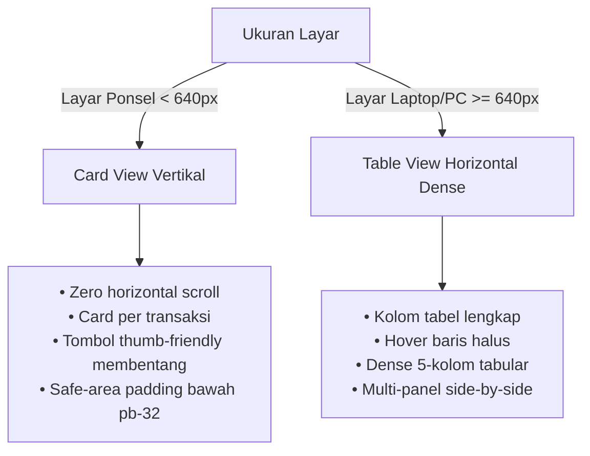

# ZailTrack Design System: Technical Archival & Editorial Ledger

> Dokumentasi arsitektur desain visual, filosofi antarmuka, token warna, tipografi, dan panduan komponen untuk ekosistem aplikasi bergaya **Technical Archival / Engineer Cockpit**.

---

## 1. Filosofi Desain (Design Philosophy)

Aesthetic ini memadukan ketelitian perangkat instrumen teknik (*industrial flight instrument / engineering terminal*) dengan elegansi tata letak editorial (*swiss typography & archival ledger*).

### Prinsip Utama:
1. **High Information Density with Zero Slop**:
   - Menghindari ilustrasi generik yang membuang ruang layar.
   - Setiap elemen memiliki fungsi nyata: metrik, status live, atau kontrol interaktif.
2. **Tactile & Hairline Precision**:
   - Menggunakan border setipis 1px (*hairline borders*) dengan kontras terkontrol untuk memisahkan hierarki tanpa membuat mata lelah.
   - Sudut melengkung yang proporsional: `rounded-lg` (8px) untuk tombol dan kontrol, `rounded-xl` (12px) untuk kartu kontainer.
3. **Monospace Asymmetry**:
   - Teks bacaan dan label menggunakan font display sans-serif yang berkepribadian tegas (`Bricolage Grotesque`).
   - Angka nominal, timestamp, metrik performa, kode, dan status status tag wajib menggunakan font monospace (`Space Mono`).
4. **Purpose-Driven Accents**:
   - Warna aksen tidak digunakan secara acak, melainkan membawa makna fungsional:
     - **Cyan / Sky (`#38bdf8`)**: Aksi navigasi & interaktivitas utama.
     - **Amber / Gold (`#f59e0b`)**: Mode Developer, status sistem, otoritas admin.
     - **Emerald / Mint (`#34d399`)**: Pemasukan, status online, saldo positif.
     - **Rose / Crimson (`#fb7185`)**: Pengeluaran, aksi destruktif (delete), peringatan.

---

## 2. Tipografi & Font Pairing

```css
:root {
  --font-sans: "Bricolage Grotesque", -apple-system, BlinkMacSystemFont, "Segoe UI", Roboto, sans-serif;
  --font-mono: "Space Mono", ui-monospace, SFMono-Regular, Menlo, Monaco, Consolas, monospace;
}
```

| Penggunaan | Font Family | Weight & Tracking | Contoh Implementasi |
| :--- | :--- | :--- | :--- |
| **Headline & Brand** | `Bricolage Grotesque` | Bold (700), `-0.02em` | `ZailTrack`, Judul Halaman |
| **Body & Deskripsi** | `Bricolage Grotesque` | Medium (500), `-0.015em` | Keterangan transaksi, instruksi |
| **Nominal & Angka** | `Space Mono` | Bold (700), Tabular | `Rp 1.000.000`, Saldo, Nilai Kas |
| **Telemetry & Badges** | `Space Mono` | Regular / Bold, `tracking-wider` | `USER // fuzail_dev`, `709 ms` |
| **Labels & Metadata** | `Space Mono` | Regular, `uppercase text-[10px]` | `SALDO BERSIH (NET)`, `TERDAFTAR SEJAK` |

---

## 3. Palet Warna (Color Palette & Tokens)

Desain mendukung mode gelap (*Dark Mode - Slate Charcoal*) dan mode terang (*Light Mode - Paper & Lead*) secara dinamis melalui CSS Variables:

### Mode Gelap (Dark Mode - Default)
```css
[data-theme="dark"] {
  --bg: #0b0d11;              /* Base canvas gelap teknikal */
  --bg-secondary: #12151c;    /* Background header tabel / kontainer lapis kedua */
  --surface: #181c25;         /* Permukaan kartu / card background */
  --surface-hover: #1f2430;   /* State hover pada list / baris */
  --border: #262c38;          /* Border utama hairline */
  --border-subtle: #1c212b;   /* Garis pemisah internal */
  --text-primary: #f3f4f6;    /* Teks judul & angka utama */
  --text-secondary: #94a3b8;  /* Teks deskripsi & label sekunder */
  --text-muted: #64748b;      /* Metadata, timestamp, placeholder */
  --accent: #38bdf8;          /* Sky Blue (Primary Action) */
  --accent-muted: rgba(56, 189, 248, 0.12);
  --income: #34d399;          /* Emerald Mint (Pemasukan) */
  --expense: #fb7185;         /* Rose Coral (Pengeluaran) */
}
```

### Mode Terang (Light Mode)
```css
[data-theme="light"] {
  --bg: #fafaf9;              /* Off-white paper canvas */
  --bg-secondary: #f4f4f5;    /* Gray neutral tint */
  --surface: #ffffff;         /* Pure white cards */
  --surface-hover: #f8fafc;   /* Subtle hover state */
  --border: #e2e8f0;          /* Clean pencil lead border */
  --border-subtle: #edf2f7;   /* Faint divider */
  --text-primary: #0f172a;    /* Deep slate ink */
  --text-secondary: #475569;  /* Charcoal body */
  --text-muted: #64748b;      /* Lead gray */
  --accent: #0284c7;          /* Cobalt blue */
  --accent-muted: rgba(2, 132, 199, 0.08);
  --income: #059669;          /* Deep emerald */
  --expense: #e11d48;         /* Deep crimson */
}
```

---

## 4. Pola Komponen (Component Patterns)

### A. Technical Card Container
Kartu bergaris tegas dengan bayangan mikro untuk efek taktil yang halus:
```html
<div className="bg-[var(--surface)] border border-[var(--border)] rounded-xl p-4 shadow-xs">
  <!-- Content -->
</div>
```

### B. Status Badges & Pills
Badge ringkas dengan latar belakang transparan 10% dan border 20-30% serasi:
- **Admin / Dev**:
  ```html
  <span className="px-1.5 py-0.5 rounded text-[10px] font-mono font-bold bg-amber-500/10 text-amber-500 border border-amber-500/30">
    ADMIN / DEV
  </span>
  ```
- **Pemasukan (Income)**:
  ```html
  <span className="px-1.5 py-0.5 rounded text-[10px] font-mono font-bold bg-emerald-500/10 text-emerald-500 border border-emerald-500/30">
    PEMASUKAN
  </span>
  ```
- **Pengeluaran (Expense)**:
  ```html
  <span className="px-1.5 py-0.5 rounded text-[10px] font-mono font-bold bg-rose-500/10 text-rose-500 border border-rose-500/30">
    PENGELUARAN
  </span>
  ```

### C. Live Telemetry / User Pill
Indikator titik lampu aktif (*active glowing dot*):
```html
<div className="flex items-center gap-1.5 text-xs text-[var(--text-muted)] font-mono">
  <span className="w-1.5 h-1.5 rounded-full bg-emerald-500 animate-pulse inline-block" />
  <span>USER // username</span>
</div>
```

### D. Segmented View Switcher (Mode User vs Mode Dev)
Kontrol mode bergaya panel instrumen kokpit:
```html
<div className="flex items-center p-0.5 rounded-lg border border-[var(--border)] bg-[var(--surface)] text-xs font-mono">
  <button className="px-3 py-1.5 rounded-md bg-[var(--text-primary)] text-[var(--bg)] font-bold shadow-xs">
    Mode User
  </button>
  <button className="px-3 py-1.5 rounded-md text-[var(--text-muted)] hover:text-amber-500">
    Mode Dev
  </button>
</div>
```

---

## 5. Pola Responsif (Responsive Dual-View Architecture)

Salah satu keunggulan desain ini adalah **perlakuan berbeda antara mobile dan desktop** untuk menjaga kenyamanan pembacaan:



### Aturan Responsif:
1. **Layar HP (< 640px)**:
   - Hindari memaksa tabel lebar 5 kolom yang mengharuskan geser horizontal.
   - Ganti baris tabel menjadi kartu individual (`block sm:hidden`).
   - Tombol utama (*primary CTA*) dibuat membentang penuh (`w-full sm:w-auto`) agar mudah dijangkau satu tangan.
   - Berikan `pb-32` pada dasar halaman agar browser floating navbar (Safari / Chrome) tidak menutupi baris data paling bawah.
2. **Layar Desktop (>= 640px)**:
   - Tampilkan seluruh kolom tabel secara proporsional (`hidden sm:block`).
   - Maksimalkan kepadatan informasi (*high density*) dengan padding `py-3.5 px-4`.

---

## 6. Panduan Do's & Don'ts

| Lakukan (Do) | Hindari (Don't) |
| :--- | :--- |
| Gunakan border tipis `1px solid var(--border)` untuk kontainer. | Jangan gunakan bayangan tebal (*heavy drop shadows / blur*) bergaya neumorphism. |
| Gunakan `Space Mono` untuk angka nominal rupiah agar digit sejajar rapi. | Jangan gunakan font tulisan tangan atau script dekoratif. |
| Gunakan warna aksen neon (cyan, amber, emerald, rose) dengan latar transparan 10%. | Jangan gunakan warna solid neon yang menyilaukan mata di mode gelap. |
| Berikan micro-interaction pada hover: `hover:bg-[var(--surface-hover)] transition-colors`. | Jangan buat elemen statis kaku tanpa umpan balik interaksi visual. |
| Pisahkan hierarki teks dengan kontras warna: `--text-primary` untuk judul, `--text-muted` untuk keterangan. | Jangan gunakan warna teks seragam abu-abu yang membuat informasi sulit dipindai. |
